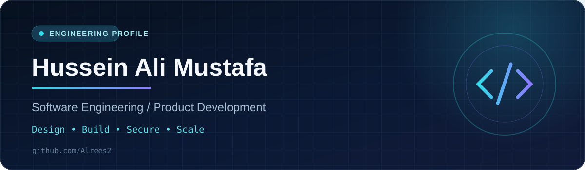

<div align="center">



### Engineering ideas into reliable digital experiences.

**Software-focused Engineer • Full-Stack & Mobile Development • Iraq**

<a href="https://github.com/Alrees2"></a>
<a href="mailto:afurolul@gmail.com"></a>
<a href="https://github.com/Alrees2/My-definition-"></a>

</div>

---

## 👋 Hello, I'm Hussein

I'm **Hussein Ali Mustafa**, a software-focused engineer and developer interested in building useful products, with hands-on work across **web applications, Flutter mobile experiences, databases, API integration, and cloud deployment**.

I care about clear interfaces, maintainable architecture, security-aware development, and building software around real needs. My projects explore **education technology, social platforms, and practical digital services**.

> **Approach:** Understand the problem → design the system → build thoughtfully → test and improve.

## ⚡ Engineering toolkit

| Area | Technologies and tools |
| --- | --- |
| **Web engineering** | HTML, CSS, JavaScript, TypeScript, React, Next.js, Vite |
| **Mobile development** | Flutter, Dart, Firebase |
| **Backend & data** | REST APIs, Laravel, Supabase, PostgreSQL |
| **Cloud & delivery** | Cloudflare Workers, Git, GitHub |
| **Product quality** | Responsive interfaces, authentication flows, debugging, deployment workflows |

<div align="center">


</div>

## 🚀 Selected engineering work

| Project | Focus | Visibility |
| --- | --- | --- |
| **EDUVERSE Iraq** | University-focused digital platform integrating academic content, administrative features and cloud-backed services. | Private codebase |
| **HAQO Flutter** | Flutter-based social mobile application work involving profiles, media, notifications and service integration. | Private codebase |
| **Seeraty Pro** | Web-based CV and professional-profile experience built with React, Vite and Supabase. | Private codebase |
| **[SocialVerse](https://github.com/Alrees2/chat)** | Arabic-first web interface exploring social interaction and responsive UI. | Public repository |
| **[Personal portfolio](https://github.com/Alrees2/My-definition-)** | Bilingual, responsive engineer portfolio built with HTML, CSS and JavaScript. | Public repository |

*Private projects are listed as high-level portfolio case studies; implementation details and source code are not published here.*

## 🧭 How I approach development

```text
01  Discover     → Understand users, requirements and constraints
02  Architect    → Organize data, services, access and interfaces
03  Implement    → Ship responsive and maintainable features
04  Verify       → Test real workflows and resolve edge cases
05  Improve      → Iterate using feedback and performance insights
```

## 🌍 A short introduction in Arabic

مرحباً، أنا **المهندس حسين علي مصطفى**، مهتم بهندسة البرمجيات وتطوير تطبيقات الويب والموبايل وبناء الأنظمة الرقمية. أعمل على مشاريع تتعلق بالتعليم والمنصات الاجتماعية والخدمات، مع اهتمام بتجربة المستخدم، تكامل قواعد البيانات، وجودة وأمان البرمجيات.

## 📈 GitHub activity

<div align="center">


</div>

<sub>Activity cards are generated by a third-party service and may occasionally be unavailable. Language counts reflect indexed public code, not a skills ranking.</sub>

---

<div align="center">

### Let's build something meaningful.

**[View my GitHub](https://github.com/Alrees2)** · **[Explore my portfolio](https://github.com/Alrees2/My-definition-)** · **[Email me](mailto:afurolul@gmail.com)**

<sub>© Hussein Ali Mustafa · Built with curiosity, discipline and an engineering mindset.</sub>

</div>
